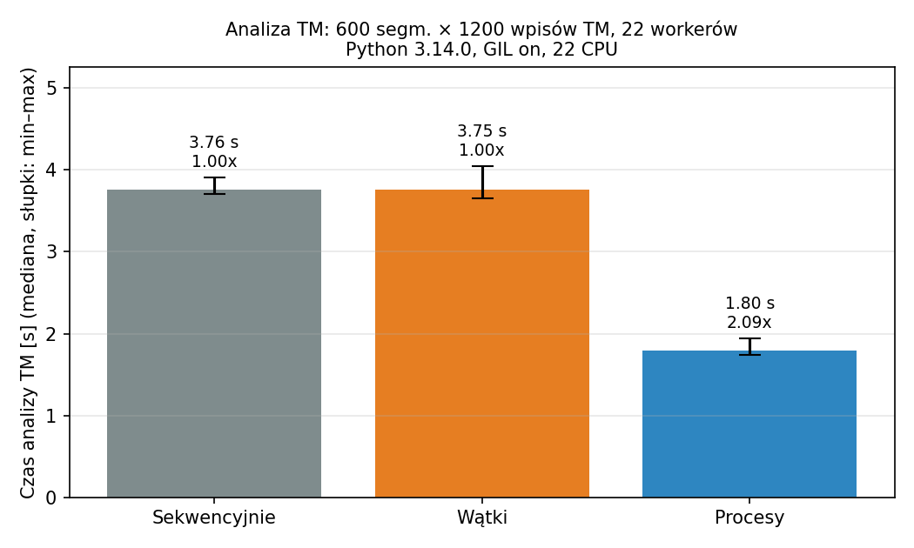

# GameCAT

GameCAT to desktopowy program CAT (*Computer-Assisted Translation*) do lokalizacji gier, przygotowany jako projekt zaliczeniowy z przedmiotu **Zaawansowane techniki programowania w języku Python**. Tłumacz importuje pliki gry (TXT, CSV, TSV, XLSX, JSON, XML), tłumaczy segmenty w edytorze Source/Target z podpowiedziami pamięci tłumaczeniowej (TM) i glosariusza, sprawdza jakość (QA) i eksportuje wynik – także do kopii oryginalnego pliku gry z zachowaniem jego struktury.

Wersja: **1.2.6** · Python 3.12+ · PySide6 · SQLite

## Uruchomienie

```bash
python -m venv .venv
.venv\Scripts\activate            # Linux/macOS: source .venv/bin/activate
python -m pip install -r requirements.txt
python main.py
```

Testy (pytest, 257 testów; testy GUI są pomijane, gdy PySide6 nie jest dostępny):

```bash
python -m pytest -q
```

Benchmark GIL (wyniki trafiają do `benchmarks/results.md`, `results.json` i `gil_benchmark.png`):

```bash
python benchmarks/gil_benchmark.py --update-readme   # pełny pomiar (600 × 1200) + tabela w README
python benchmarks/gil_benchmark.py --quick           # szybkie sprawdzenie działania
```

Dane testowe znajdują się w `sample_data/` (pliki źródłowe we wszystkich formatach, profile mapowania, glosariusz i TM). Dane do benchmarku generuje deterministycznie `benchmarks/dataset.py`.

## Funkcje

- **Projekty w SQLite** – jeden plik `.sqlite` może zawierać kilka projektów; przy otwieraniu wybiera się projekt.
- **Import i eksport** – TXT/CSV/JSON oraz TSV/XLSX/XML i zagnieżdżony JSON z konfigurowalnym profilem mapowania pól (klucz, Source, Target, komentarz). CSV rozpoznaje separator `,` `;` tab `|`. Eksport „według oryginalnego szablonu” zapisuje tłumaczenia w kopii pliku gry, nie zmieniając pozostałych pól.
- **Edytor segmentów** – szkice Target i komentarza są trzymane w pamięci; **Zapisz** utrwala status `TRANSLATED`, **Zatwierdź** – `REVIEWED`, **LQA** – `APPROVED`. Każda akcja trafia do historii segmentu.
- **Workflow statusów** `NEW → TRANSLATED → REVIEWED → APPROVED` z masową zmianą, filtrami i licznikiem postępu.
- **Wyszukiwanie** w Source/Target (także regex), filtry QA/TM, sortowanie i masowa zamiana w Target z podglądem. W dużych projektach filtrowanie działa w tle na wirtualnej liście.
- **QA** – brakujące/nadmiarowe placeholdery i tagi, puste tłumaczenie, `Source == Target`, nowe linie, spacje, wymagane terminy z glosariusza; skan całego projektu z nawigacją do błędów.
- **Glosariusz** z wieloma wariantami tłumaczenia; terminy w Source są podkreślone i klikalne; import/eksport CSV i JSON.
- **Pamięć tłumaczeniowa** – sugestie fuzzy z progiem, osobna (zewnętrzna) baza TM, import/eksport CSV i JSON, automatyczne dodawanie zatwierdzonych segmentów.
- **Analiza projektu względem TM** w progach 100% / 95–99 / 85–94 / 75–84 / 50–74 / brak – sekwencyjnie, w wątkach lub w procesach – z pretranslacją pustych segmentów.
- **OpenAI API (opcjonalnie)** – tłumaczenie pojedyncze i wsadowe z limitem kosztu; propozycje są sprawdzane regułami QA. Klucz API jest przechowywany w systemowym magazynie poświadczeń, nigdy w pliku projektu.

Najważniejsze skróty: `Ctrl+S` zapisz segment · `Ctrl+Enter` zapisz segment (jak przycisk Zapisz) · `Alt+↓/↑` następny/poprzedni segment · `Ctrl+1…4` status · `Ctrl+F` szukaj · `Ctrl+H` zamień w Target · `F8 / Shift+F8` następny/poprzedni błąd QA · `Ctrl+Alt+↓/↑` następny/poprzedni bez tłumaczenia · `Ctrl+Shift+Q` QA projektu · `Ctrl+Shift+A` analiza TM · `Ctrl+Shift+T` tłumaczenie AI.

## Struktura projektu

| Katalog | Zawartość |
|---|---|
| `gamecat/models/` | modele domenowe: projekt, segment, termin glosariusza, wpis TM |
| `gamecat/database/` | połączenie SQLite bezpieczne wątkowo, schemat i migracje, repozytoria, iterator segmentów |
| `gamecat/importers/`, `exporters/`, `localization/` | importery-generatory, eksportery, profile formatów, XLSX, eksport do szablonu |
| `gamecat/services/` | fasada `ProjectService` (`project_service.py`) złożona z mixinów w `services/project/` |
| `gamecat/qa/`, `glossary/`, `tm/`, `search/`, `workflow/` | reguły QA, glosariusz, podobieństwo i analiza TM, wyszukiwanie, statusy |
| `gamecat/concurrency/` | kolejka zapisów w tle (`SaveQueue`) i pula wątków I/O |
| `gamecat/gui/` | interfejs PySide6; okno główne `main_window.py` złożone z mixinów w `gui/window/` |
| `gamecat/ai/` | opcjonalna integracja z OpenAI API |
| `benchmarks/` | benchmark GIL i generator danych |
| `tests/` | testy jednostkowe, integracyjne i GUI (pytest) |

## Mapowanie wymagań zaliczeniowych

| Zagadnienie | Gdzie w kodzie | Gdzie działa w programie |
|---|---|---|
| Dekorator funkcji + `functools.wraps` | `gamecat/utils/decorators.py` → `measure_time` | czas importu, eksportu, QA i analizy TM w logu `gamecat.timing` (`services/project/files.py`, `tm.py`, `quality.py`) |
| Dekorator z parametrami | `gamecat/utils/decorators.py` → `retry(attempts, delay, exceptions, when)` | `concurrency/save_queue.py` → `SaveQueue._save_batch`: ponowienie zapisu, gdy plik bazy blokuje inny proces |
| Dekorator funkcji i dekorator klasy | `gamecat/database/repositories.py` → `database_errors`, `repository_errors` | błędy `sqlite3` w repozytoriach zamieniane na `DatabaseError` |
| Dekorator metody korzystający z `self` | `gamecat/utils/decorators.py` → `requires_project` | metody okna głównego wymagające otwartego projektu (`gui/window/*.py`) |
| `@property` z setterem | `gamecat/models/segment.py` → `Segment.target`, `Segment.status` | walidacja każdej zmiany tłumaczenia i statusu |
| `@classmethod` | `localization/profiles.py` → `FormatProfile.from_dict`, `workflow/status.py` → `ProjectProgress.from_counts`, `search/index.py` → `SearchRecord.from_segment` | alternatywne konstruktory |
| `@staticmethod` | `concurrency/save_queue.py` → `SaveQueue._snapshot`, `_coalesce`; `services/project/files.py` → `_export_file` | autosave, eksport |
| Własny iterator (`__iter__`, `__next__`) | `gamecat/database/segment_iterator.py` → `SegmentBatchIterator`; `services/project/files.py` → `_CountingIterator` | QA projektu, eksport i analiza TM czytają segmenty z SQLite partiami (keyset pagination); zliczanie eksportu bez listy w pamięci |
| Funkcje-generatory (`yield`) | `gamecat/importers/*.py`, `localization/exchange.py` → `_read_*_source`, `benchmarks/dataset.py` → `_sentences` | strumieniowy import wszystkich formatów |
| `yield from` | `localization/exchange.py` → `read_source`, `read_translations`; `qa/rules.py` → `iter_issues` | dyspozytor delegujący czytanie do generatora właściwego formatu; łączenie grup reguł QA w jeden strumień |
| Wyrażenia generujące | `services/project/files.py` → `_import_file`; `services/project/tm.py` → `analyze_project_tm`, `sync_project_to_tm`; `database/segment_iterator.py` → `_fetch_batch` | import w jednej transakcji, przygotowanie danych do analizy |
| Regex z grupami nazwanymi | `gamecat/qa/patterns.py` → `BRACE_RE`, `PRINTF_OR_TAG_RE` (`brace`, `printf`, `tag`) | QA placeholderów i tagów |
| Regex – tokenizacja i wyszukiwanie | `tm/similarity.py` → `_WORD_RE`, `tm/analysis.py` → `_WORD_RE`, `glossary/matching.py` → `contains_term`, `search/operations.py` → `_regex` | fuzzy matching TM, liczenie słów, terminy glosariusza, wyszukiwanie regex |
| Wątki + `Queue` / `Lock` / `RLock` / `Event` | `concurrency/save_queue.py` → `SaveQueue`; `concurrency/io_workers.py` → `IOWorkerPool`; `database/connection.py` → `ThreadSafeConnection`; `gui/segment_editor.py` → wyszukiwanie w tle z `Event` | autosave w tle, import/eksport bez blokowania GUI, anulowanie wyszukiwania |
| Procesy | `gamecat/tm/analysis.py` → `analyze()` (`ProcessPoolExecutor`, kontekst `spawn`, `initializer`) | **TM → Analiza projektu względem TM** (`Ctrl+Shift+A`) |
| Pomiar GIL | `benchmarks/gil_benchmark.py` | ta sama analiza TM: sekwencyjnie / wątki / procesy |
| Testy | `tests/` (pytest) | |
| CLI | `benchmarks/gil_benchmark.py`, `benchmarks/search_124.py` (`argparse`) | |
| Logging | `gamecat/logging_config.py` | plik `gamecat.log` |
| Wykres wyników | `benchmarks/gil_benchmark.py` → `save_plot` (matplotlib) | `benchmarks/gil_benchmark.png` |

## Wyniki benchmarku GIL

<!-- BENCHMARK:START -->
| Tryb | Mediana [s] | Min [s] | Max [s] | Przyspieszenie |
|---|---:|---:|---:|---:|
| Sekwencyjnie | 3.759 | 3.701 | 3.909 | 1.00x |
| Wątki | 3.754 | 3.655 | 4.047 | 1.00x |
| Procesy | 1.796 | 1.745 | 1.942 | 2.09x |

Dane: 600 segmentów × 1200 wpisów TM, 22 workerów, 5 powtórzeń (mediana), seed 2026.  
Środowisko: Python 3.14.0 (CPython), Windows 11, 22 rdzeni logicznych, GIL włączony.


<!-- BENCHMARK:END -->

## Wnioski z benchmarku GIL

Pomiar dotyczy rzeczywistej operacji programu – analizy projektu względem TM, w której każdy segment jest porównywany z każdym wpisem pamięci funkcją podobieństwa napisaną w czystym Pythonie, czyli zadania typu CPU-bound. Wszystkie trzy tryby zwróciły identyczne wyniki, a pomiar obejmował rozgrzewkę, pięć rund z rotacją kolejności trybów i medianę czasu. Wątki nie dały żadnego przyspieszenia (1,00×): przy włączonym GIL w danej chwili tylko jeden wątek wykonuje kod bajtowy Pythona, więc 22 wątki liczyły po kolei. Procesy skróciły czas o ponad połowę (2,09×), bo każdy ma własny interpreter i własny GIL, a więc faktycznie korzysta z kilku rdzeni. Przyspieszenie jest dużo mniejsze niż liczba rdzeni, ponieważ czas obejmuje start puli procesów w trybie `spawn` i przekazanie danych przez pickle; dlatego TM trafia do procesów tylko raz, przez `initializer`. Z tego samego powodu projekty mniejsze niż 200 segmentów są analizowane sekwencyjnie – przy małej pracy narzut procesów przeważa nad zyskiem. Wątki pozostają w GameCAT właściwym narzędziem dla zadań I/O-bound: importu, eksportu, zapisów do SQLite i zapytań do OpenAI API. Na kompilacji free-threading (Python 3.13t/3.14t) wątki mogłyby przyspieszać także tę analizę, co można sprawdzić tym samym skryptem.

## Problemy napotkane podczas realizacji

- **Wyścig przy zapisie do SQLite.** Wątek autosave i wątek GUI korzystały ze wspólnego połączenia, co prowadziło do przeplatania transakcji. Rozwiązaniem jest `ThreadSafeConnection`, które serializuje wywołania i całe transakcje blokadą `RLock`.
- **Zapis przy każdym naciśnięciu klawisza.** Synchroniczny zapis spowalniał edytor. `SaveQueue` przenosi zapis do osobnego wątku i scala szybkie zmiany tego samego segmentu (debounce), a `flush()` wyznacza granicę trwałości przed QA, eksportem i zamknięciem projektu.
- **Częściowy import.** Zapis segmentów w osobnych transakcjach był wolny, a błąd w połowie pliku zostawiał w bazie część danych. Import działa teraz w jednej transakcji, a generator importera jest konsumowany wewnątrz niej.
- **Źle dobrana granulacja procesów.** Pierwsza wersja tworzyła pulę procesów dla pojedynczego zapytania i przesyłała TM z każdym zadaniem; narzut był większy niż zysk. Procesy opłacają się dopiero dla analizy całego projektu, z TM przekazaną raz przez `initializer`.
- **Wiarygodność pomiarów.** Pierwszy benchmark mierzył tryby zawsze w tej samej kolejności i bez rozgrzewki, przez co wyniki potrafiły sugerować przyspieszenie wątków, sprzeczne z działaniem GIL. Obecna wersja rozgrzewa każdy tryb, sprawdza zgodność wyników, rotuje kolejność i raportuje medianę.
- **Zamrażanie GUI przy dużych projektach.** Odbudowa `QListWidget` po każdym znaku zawieszała interfejs przy kilkudziesięciu tysiącach segmentów. Lista jest teraz wirtualna (`QAbstractListModel`), a filtrowanie odbywa się w tle na niemutowalnej migawce indeksu.
- **Zbyt duże moduły.** Okno główne (ok. 1600 linii) i fasada `ProjectService` (ok. 960 linii) zostały podzielone na mixiny według obszarów (menu, projekt, edycja, glosariusz, TM, QA, pliki, AI). Testy, które wykonywały metody okna przez AST, szukają ich teraz we wszystkich plikach okna (`tests/gui_source.py`).

## Historia wersji

| Wersja | Najważniejsze zmiany |
|---|---|
| 0.1–0.6 | edytor, SQLite, import/eksport TXT/CSV/JSON, QA, autosave w tle, analiza TM w procesach, benchmark GIL |
| 0.7–0.9 | glosariusz z wariantami, zewnętrzna baza TM, zaawansowane wyszukiwanie i masowa zamiana |
| 0.10–0.11 | OpenAI API, formaty TSV/XLSX/XML i profile mapowania, eksport do szablonu |
| 1.0–1.1 | stabilizacja bazy i wielu projektów, fasada `ProjectService`, operacje w tle z odrzucaniem nieaktualnych wyników |
| 1.2 | historia zatwierdzeń, glosariusz kontekstowy, zawijanie tekstu, wirtualna lista, poprawki CSV |
| 1.2.6 | podział okna głównego i `ProjectService` na mixiny, `yield from` w imporcie i QA, polskie docstringi, porządek w dokumentacji |
