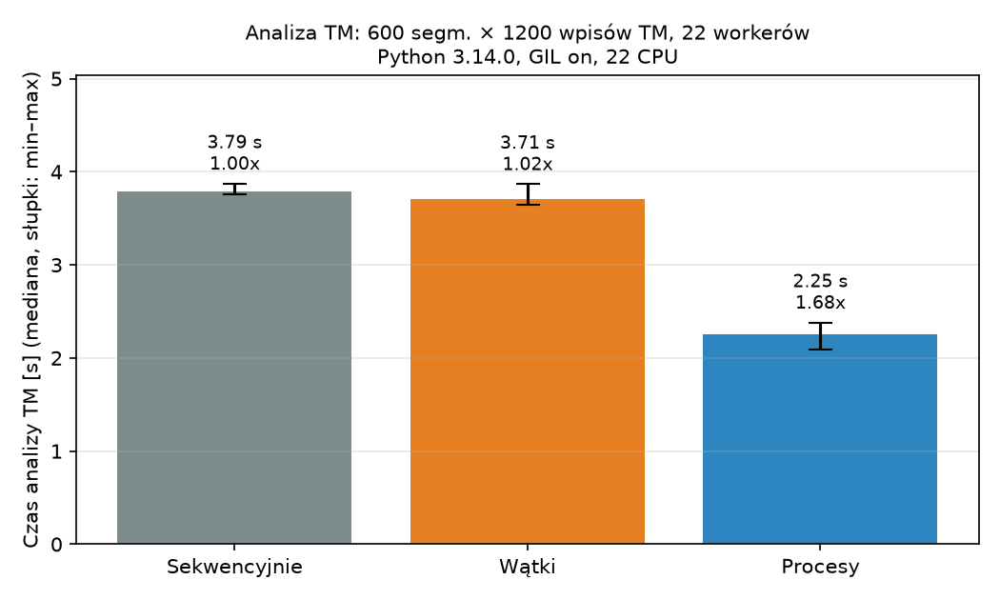

# GameCAT 1.0 — sprawozdanie z projektu zaliczeniowego

**Przedmiot:** Zaawansowane techniki programowania w języku Python  
**Temat:** GameCAT — aplikacja CAT do lokalizacji gier z pamięcią tłumaczeniową, QA i równoległą analizą  
**Technologia:** Python ≥3.12, PySide6, SQLite, pytest, matplotlib, opcjonalnie OpenAI API  
**Autor:** do uzupełnienia przez osobę oddającą projekt  
**Repozytorium Git:** do uzupełnienia po publikacji (link wymagany przy oddawaniu na Moodle)

## 1. Problem i cel

Przy tłumaczeniu gier trzeba przetwarzać pliki zawierające tysiące wypowiedzi, identyfikatory, zmienne oraz znaczniki formatowania. Ręczna edycja bez wsparcia prowadzi do niespójności terminologii, utraty placeholderów i trudności z oceną postępu. GameCAT udostępnia edytor Source/Target, pamięć tłumaczeniową (TM), glosariusz, weryfikację jakości (QA), import i eksport oraz zarządzanie stanem pracy. Założeniem projektu było użycie zaawansowanych konstrukcji Pythona **w rzeczywistych zadaniach**, a nie jako niepowiązanych demonstracji.

## 2. Funkcjonalność i architektura

Użytkownik zakłada projekt w pliku SQLite, importuje segmenty i tłumaczy je w edytorze. System zapisuje zmiany w tle, zlicza statusy `NEW`, `TRANSLATED`, `REVIEWED`, `APPROVED`, sprawdza poprawność terminologii i placeholderów, podpowiada dopasowania TM oraz eksportuje tłumaczenie. W wersji 1.0 zachowano obsługę formatów TXT, CSV, JSON, TSV, XLSX oraz XML, w tym profile dla struktur zagnieżdżonych i eksport do oryginalnego szablonu.

Podział odpowiedzialności:

- `gamecat/models/` — obiekty projektu, segmentu, glosariusza i TM;
- `gamecat/database/` — SQLite, schemat, migracje, repozytoria i iterator;
- `gamecat/importers/`, `gamecat/exporters/`, `gamecat/localization/` — pliki i profile;
- `gamecat/services/project_service.py` — spójne operacje aplikacyjne;
- `gamecat/qa/`, `gamecat/glossary/` i `gamecat/tm/` — walidacja, terminologia, fuzzy matching;
- `gamecat/concurrency/` — kolejka autosave i zadania I/O;
- `gamecat/gui/` — interfejs desktopowy (PySide6);
- `gamecat/ai/` — opcjonalne OpenAI API, sugestie wstępnie weryfikowane przez QA;
- `benchmarks/` — dane syntetyczne i porównanie GIL;
- `tests/` — testy jednostkowe, integracyjne oraz warunkowe testy GUI.

## 3. Mapowanie wymagań z materiałów prowadzącego

| Obowiązkowe zagadnienie | Konkretna implementacja i zastosowanie |
|---|---|
| **2 dekoratory funkcji, w tym jeden parametryzowany, `wraps`** | `gamecat/utils/decorators.py`: `measure_time` (pomiar czasów importu, eksportu, QA); `retry(attempts, delay, exceptions, when)` (ponowienia przejściowej blokady SQLite w `SaveQueue`) |
| **Dekorator metody korzystający z `self`; `property`/`staticmethod`** | `gamecat/utils/decorators.py`: `requires_project` na metodach `MainWindow`; `gamecat/models/segment.py`: `Segment.target` i `Segment.status` z setterami; `SaveQueue._snapshot` |
| **Własny iterator** | `gamecat/database/segment_iterator.py`: `SegmentBatchIterator.__iter__`, `__next__` — pobieranie segmentów z SQLite partiami |
| **Generatory i wyrażenia generujące** | `gamecat/importers/txt_importer.py`, `csv_importer.py`, `json_importer.py` — `yield` przy imporcie; `ProjectService._import_file` — leniwy strumień nowych segmentów |
| **Co najmniej 2 regex, grupy nazwane** | `gamecat/qa/patterns.py`: `BRACE_RE`, `PRINTF_OR_TAG_RE` (nazwane grupy); `gamecat/tm/similarity.py` — regex tokenizacji |
| **Wątki I/O + synchronizacja** | `gamecat/concurrency/io_workers.py`: `ThreadPoolExecutor` import/eksport; `save_queue.py`: `Queue`, `Lock`; `database/connection.py`: `RLock` |
| **Procesy CPU-bound** | `gamecat/tm/analysis.py`: `ProcessPoolExecutor` i `initializer` pamięci TM; analiza podobieństwa segmentów |
| **GIL: sekwencyjnie / wątki / procesy** | `benchmarks/gil_benchmark.py`; wspólny algorytm `analyze`, rozgrzewka, kontrola wyników, rotacja kolejności, mediana i wykres |

Repozytorium obejmuje `requirements.txt`, type hints w kluczowych modułach, docstringi, obsługę wyjątków i próbki w `sample_data/`. Historia rozwoju jest zachowana w Git i w pliku `.bundle` dołączonym do wydania.

## 4. Scenariusz działania

1. Uruchomić `python main.py`, utworzyć projekt EN→PL i zaimportować `sample_data`.
2. Zaznaczyć segment, wpisać lub zaimportować Target i zapisać `Ctrl+S`.
3. Wprowadzić dwa dopuszczalne warianty jednego terminu do glosariusza; uruchomić QA.
4. Potwierdzić segment jako `APPROVED`; sprawdzić sugestie i analizę TM.
5. Wyeksportować tłumaczenie; przy JSON/XML skorzystać z profilu i szablonu.
6. Zamknąć i ponownie otworzyć bazę `.sqlite`; segmenty i statusy pozostają zapisane.

## 5. Testy i weryfikacja

W środowisku wydania 1.0 (`CPython 3.13.5`, Linux) polecenie `python -m pytest -q` zakończyło się wynikiem **160 passed, 12 skipped, 0 failed**. Testy obejmują model, repozytoria, migrację glosariusza, współbieżny zapis, QA, TM, import/eksport, AI z atrapą klienta API i test akceptacyjny pełnego przepływu. `python -m compileall -q gamecat benchmarks tests main.py` zakończyło się bez błędów. Nie wykonano płatnych wywołań OpenAI API.

**Ograniczenie testów:** 12 pominiętych testów wymaga PySide6, którego nie ma w tym środowisku. Oznacza to, że należy dodatkowo wykonać ręczny scenariusz z `docs/gui_acceptance_checklist.md` na Windows z zainstalowanym PySide6. `compileall` sprawdza składnię, **nie** zastępuje uruchomienia GUI.

Dodatkowe zabezpieczenie wprowadzone w 1.0: ponowny import zmienionego tłumaczenia nie zachowuje poprzedniego statusu `REVIEWED`/`APPROVED`, lecz cofa status do `TRANSLATED` (lub `NEW`, jeśli tekst wyczyszczono). Identyczny import zachowuje recenzję. Potwierdzają to testy w `tests/test_translation_import.py` i `tests/test_release_100.py`.

## 6. Benchmark GIL — procedura i wyniki

Uruchomiono **ten sam algorytm** analizy TM dla trzech trybów, po rozgrzewce i sprawdzeniu zgodności wyników. Test 1.0: 160 segmentów, 240 wpisów TM, 2 workery, seed 2026, trzy rundy (rotowana kolejność), wynik jako mediana:

| Tryb | Mediana [s] | Przyspieszenie do sekwencyjnego |
|---|---:|---:|
| Sekwencyjnie | 0,260 | 1,00× |
| Wątki | 0,244 | 1,06× |
| Procesy | 1,152 | 0,23× |

**Interpretacja (8 zdań).** Analiza podobieństwa segmentów TM jest zadaniem CPU-bound. Przy włączonym GIL standardowy CPython nie wykonuje jednocześnie kodu bajtowego Pythona w wielu wątkach tego samego procesu. Dlatego wątki nie dają niezawodnego przyspieszenia w takich zadaniach, nawet jeśli niektóre pomiary różnią się o kilka procent. Każdy proces posiada własny interpreter i może wykonywać obliczenia równolegle. Uruchomienie procesów wymaga jednak czasu i przekazywania danych między nimi. Dla małego zbioru użytego w pomiarze 1.0 ten narzut przewyższył zysk, więc procesy były wolniejsze. W historycznym pomiarze 0.5.1 na Windows 11 (600 × 1200; 22 workery) procesy osiągnęły 2,09×, wątki 1,00×, co pokazuje znaczenie rozmiaru danych i sprzętu. W praktyce GameCAT używa wątków do I/O, a równoległą analizę TM uruchamia w procesach dla dostatecznie dużych zadań, z możliwością pracy sekwencyjnej.

Wyniki surowe i parametry są w `benchmarks/results.json`, tabelaryczne w `benchmarks/results.md`, wykres w `benchmarks/gil_benchmark.png`. Historia osobnego pomiaru Windows: `benchmarks/history_0.5.1_windows.md`. Komenda odtworzenia: `python benchmarks/gil_benchmark.py --segments 160 --tm 240 --repeats 3 --workers 2 --update-readme`.

## 7. Napotkane problemy i rozwiązania

- **Współbieżne operacje SQLite.** Oddzielne ścieżki GUI i autosave potrzebowały synchronizacji. Zastosowano `RLock` i pojedynczą kolejkę zapisu.
- **Zapis każdej litery.** `SaveQueue` scala kolejne zmiany segmentu i wystawia `flush()` jako granicę trwałości.
- **Import źródeł gier.** Różne struktury plików wymagają deklaratywnych profili mapowania, a eksport do oryginalnego szablonu musi sprawdzać zgodność identyfikatorów i tekstu Source.
- **Koszt multiprocessingu.** Dla małych danych procesy są wolniejsze, więc wynik benchmarku należy interpretować wraz z rozmiarem danych i kosztami startu.
- **Stan workflow a import.** Nowy import Target mógł zachować poprzednie `APPROVED`; w 1.0 poprawiono przejścia statusów i dołączono testy regresyjne.

## 8. Ograniczenia i rozwój

Program nie interpretuje wszystkich własnościowych archiwów gier i nie gwarantuje identyczności bajtowej ponownej serializacji JSON/XML. Płatne OpenAI API wymaga własnego klucza i świadomej zgody na wysłanie tekstu; limit kosztu jest szacunkowy. Testy GUI i żywego OpenAI API wymagają weryfikacji na komputerze użytkownika. Potencjalne rozszerzenia: XLIFF/TMX, obsługa konkretnych formatów gier i integracja lokalnego LLM, poza zakresem wydania zaliczeniowego.

## 9. Instrukcja uruchomienia i przekazania

W katalogu głównym: `python -m venv .venv`, aktywować środowisko, `python -m pip install -r requirements.txt`, następnie `python main.py`. Testy: `python -m pytest -q`, benchmark: komenda z punktu 6. Na Moodle należy umieścić dokument zawierający **rzeczywisty link do opublikowanego repozytorium** i ścieżkę do projektu (katalog główny, gałąź/tag wydania). Repozytorium GitHub/GitLab musi zostać opublikowane przez właściciela — sama lokalna paczka ZIP lub `.bundle` nie tworzy publicznego linku.
